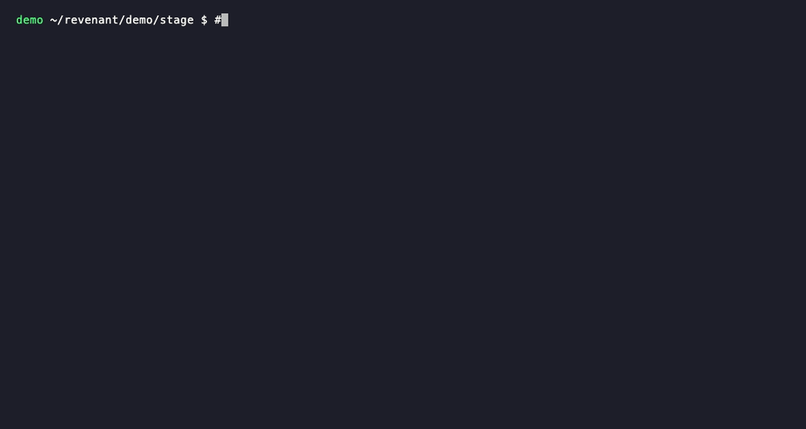

# revenant

A haunted terminal for the DEV Hacktoberfest Week 4 challenge, "Ghost in the Machine".
After a command finishes, a local Gemma may whisper one short line about **your own shell history**:

```
👻 Streaks bloom, reflecting a silent, distant sorrow. It has been 90 days since you ran `docker compose up` (2026-07-29).
```

The second half is written by code from a real entry in your history (date, command, exit code).
Gemma only writes the atmospheric first half, and a validator drops any line that states a fact.
If anything looks wrong, or Ollama is down, the Ghost stays silent.



The demo is recorded in a throwaway shell with a **fabricated** history and stand-in `docker`/`git`/`make`/`npm` scripts (`demo/record.sh`, needs [vhs](https://github.com/charmbracelet/vhs)); none of the commands are real.

Work in progress. Python 3.13+, [uv](https://docs.astral.sh/uv/), [Ollama](https://ollama.com) with `gemma3:12b` (and `gemma3:4b` as a fallback).

## Try it in a throwaway shell (touches nothing)
```bash
uv sync
zsh -f            # a shell with none of your config
source shell/revenant.zsh
```

## Safety
- Read-only: it reads `~/.zsh_history`; it never edits it and never runs anything from it.
- The hook records only the command, exit code and duration (never the output).
- Secrets (tokens, URLs, emails, IPs, long numbers) are hidden before the model sees anything; the model runs locally.
- State lives in `~/.local/state/revenant` (mode 700). The log holds no command text; the spool does, so keep that folder private.
- Off switches: `revenant off`, `revenant mute 30`, or `zsh -f`. Remove it by deleting the one `source` line and `~/.local/state/revenant`.

## Commands
`revenant status`, `off`, `on`, `mute [minutes]`, `unmute`, `stats`. `REVENANT_MODELS` (default `gemma3:12b,gemma3:4b`) picks the models, first one first.

## Tests
```bash
uv run pytest
```
